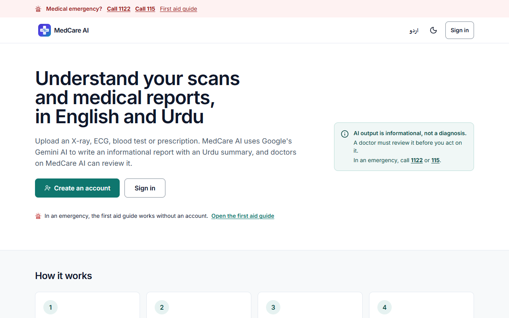
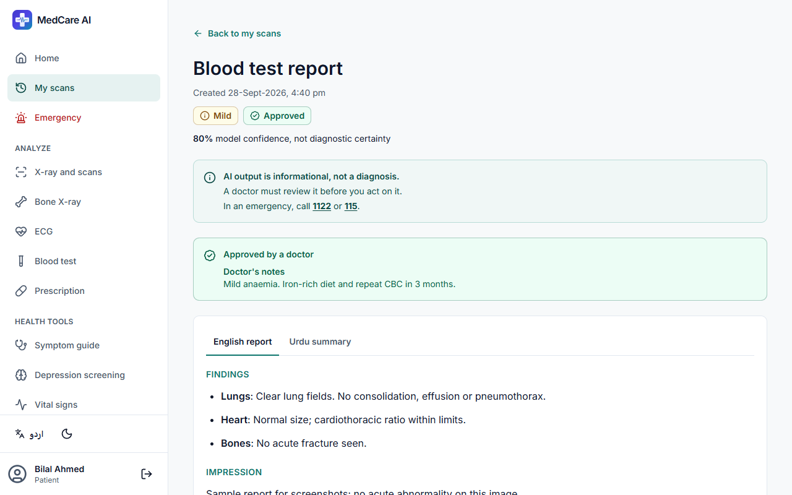
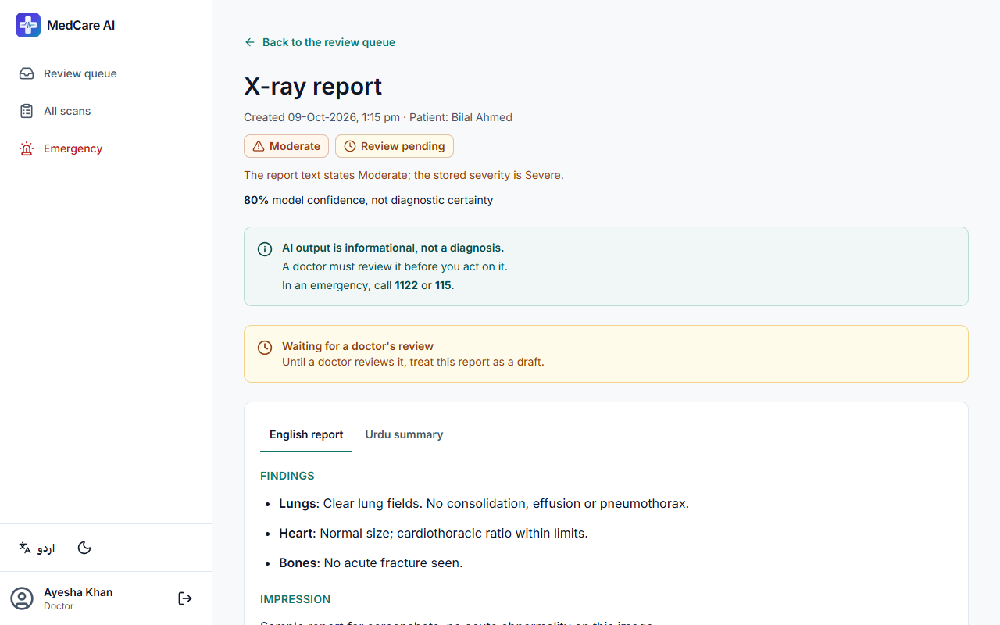
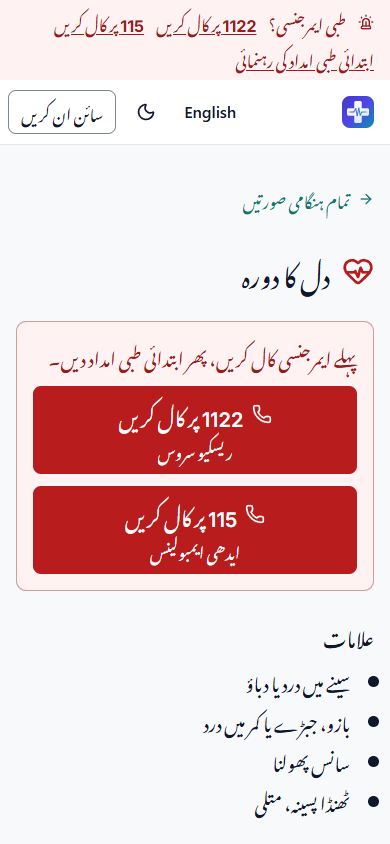

# MedCare AI frontend

React 19, TypeScript and Vite single-page app for MedCare AI, in English and Urdu (right to left). It talks to the FastAPI backend in `../backend`; the backend's endpoints and payloads are unchanged. [CHANGELOG.md](CHANGELOG.md) lists what the rebuild changed and removed, and every medical-content change for review.

| Landing page | Urdu, dark theme | Report with doctor's notes |
|---|---|---|
|  |  |  |

| Doctor review | First aid in Urdu |
|---|---|
|  |  |

Screenshots use made-up sample data.

## Setup

```bash
npm install
cp .env.example .env   # set VITE_API_URL if you are not using the production backend
npm run dev            # http://localhost:5173
```

`VITE_API_URL` is the backend base URL including `/api/v1`. When it is not set, the app falls back to the production Cloud Run URL in `src/config.ts`.

## Scripts

| Script | What it does |
|---|---|
| `npm run dev` | Dev server with hot reload; `/design` shows the design system (dev only) |
| `npm run build` | Production build into `dist/` |
| `npm run preview` | Serve `dist/` on http://localhost:4173 |
| `npm run typecheck` | TypeScript in strict mode, for the app, the configs and the e2e tests |
| `npm run lint` | ESLint, including a rule that rejects hard-coded UI text |
| `npm test` | Unit and component tests (Vitest and Testing Library) |
| `npm run test:e2e` | Playwright tests against a mocked API: patient and doctor journeys, navigation, and axe plus overflow checks on every route |

The e2e tests build the app into `dist-e2e/` with `VITE_API_URL` pointing at a made-up origin that `e2e/mock-api.ts` answers, so they never reach the real backend or Gemini. They use the installed Google Chrome (`channel: 'chrome'`).

## How the code is organised

| Folder | Contents |
|---|---|
| `src/app` | Routes (`routes.tsx`, lazy loaded per page), providers, error and 404 pages |
| `src/components` | Shared components; `ui/` holds the shadcn-style primitives built on Radix |
| `src/features` | One folder per area: `auth`, `analyzer`, `report`, `scans`, `patient`, `doctor`, `tools`, `emergency`, `landing`, `legal` |
| `src/services` | The typed API client (`api.ts`), error mapping and the session store |
| `src/i18n` | i18next setup and the `en` / `ur` JSON files; a test checks that both languages have the same keys, list items and placeholders |
| `e2e` | Playwright tests and the mocked API |

Every string shown to users lives in `src/i18n/locales`. Colours are CSS variables in `src/index.css`, with light and dark values that meet WCAG AA.

## Deploying on Vercel

`vercel.json` sets the Vite framework preset, the `dist` output folder and a rewrite so every route serves `index.html`. In the Vercel project settings, rename the environment variable `REACT_APP_API_URL` to `VITE_API_URL`.
